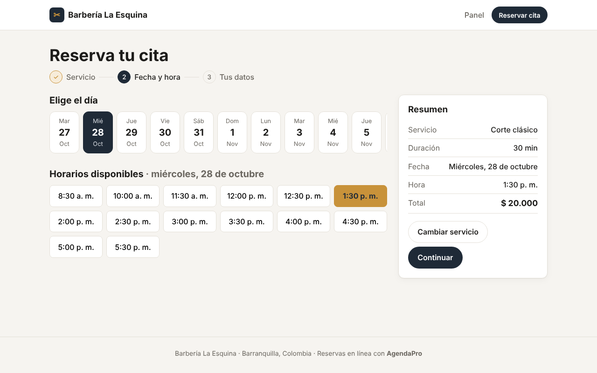
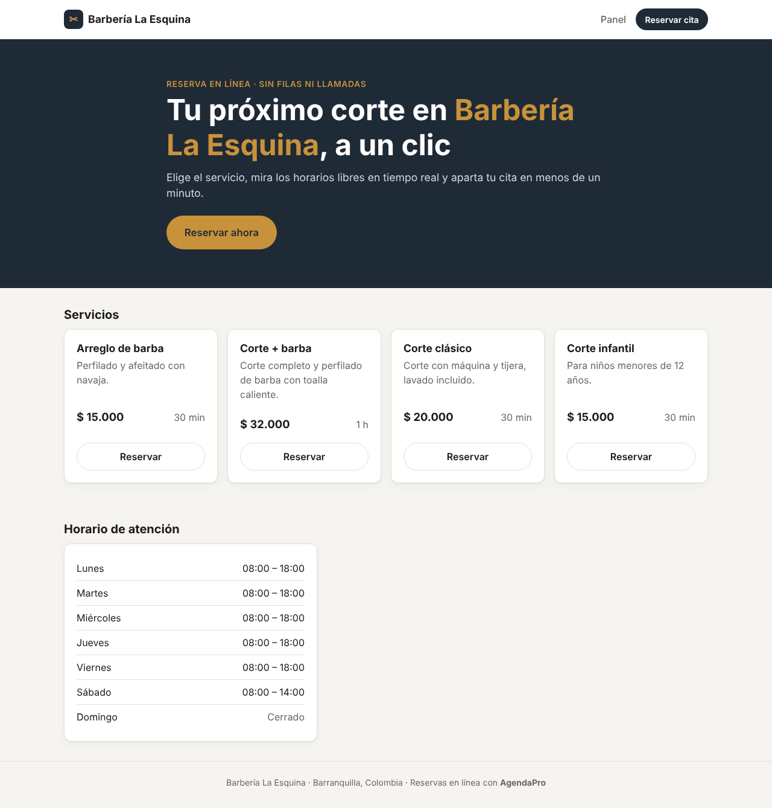
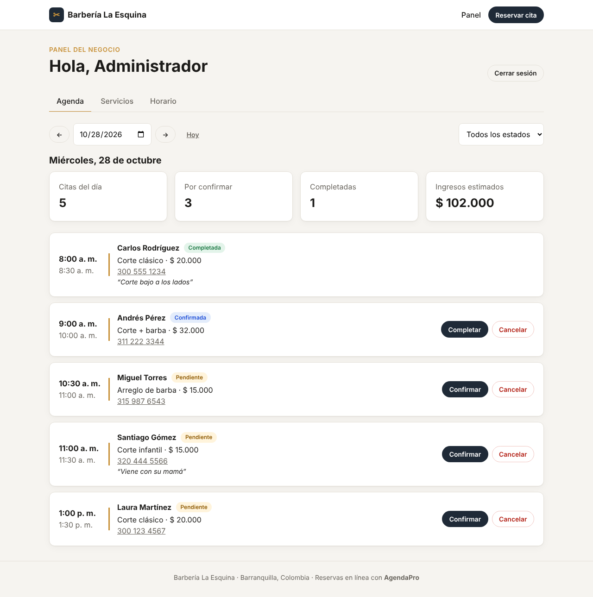
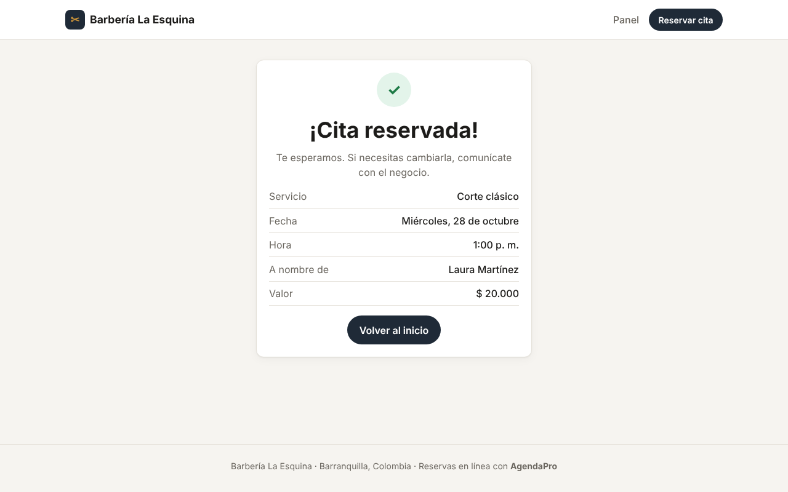
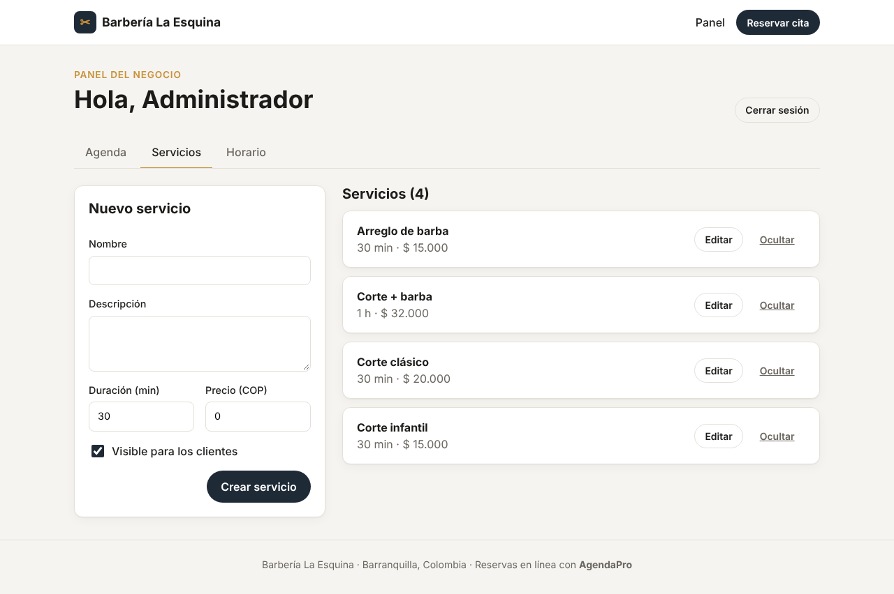
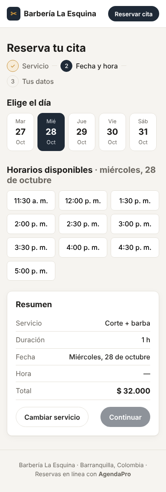

# AgendaPro · Sistema de reservas de citas

[](https://github.com/jgamerot07-prog/AGENDAS-DE-CITAS-/actions/workflows/ci.yml)


Aplicación web **full stack** para que negocios locales (barberías, peluquerías, consultorios) reciban reservas en línea.
El cliente elige un servicio, ve los horarios libres en tiempo real y aparta su cita en menos de un minuto;
el negocio gestiona su agenda desde un panel de administración.



## Contenido

- [Funcionalidades](#funcionalidades)
- [Capturas](#capturas)
- [Tecnologías](#tecnologías)
- [Decisiones técnicas](#decisiones-técnicas)
- [Estructura del proyecto](#estructura-del-proyecto)
- [API REST](#api-rest)
- [Cómo ejecutarlo](#cómo-ejecutarlo)
- [Pruebas](#pruebas)
- [Despliegue](#despliegue)
- [Próximas mejoras](#próximas-mejoras)

## Funcionalidades

**Para los clientes**

- Catálogo de servicios con precio y duración.
- Reserva en 3 pasos: servicio → fecha y hora → datos de contacto.
- Horarios disponibles calculados en tiempo real según el horario del negocio, la duración del servicio y las citas ya reservadas.
- Mensajes de error claros y validación de cada campo.
- Diseño adaptable a celular.

**Para el negocio (panel con inicio de sesión)**

- Agenda diaria con navegación por fechas y filtro por estado.
- Resumen del día: citas, pendientes por confirmar, completadas e ingresos estimados.
- Flujo de estados de la cita: `pendiente → confirmada → completada` o `cancelada`.
- Gestión de servicios: crear, editar, ocultar y mostrar.
- Configuración del horario de atención por día de la semana.

## Capturas

| Inicio | Panel del negocio |
| --- | --- |
|  |  |

| Confirmación | Gestión de servicios | Celular |
| --- | --- | --- |
|  |  |  |

## Tecnologías

| Capa | Herramientas |
| --- | --- |
| Frontend | React 19, React Router 7, Vite, CSS propio (sin frameworks) |
| Backend | Node.js 22, Express 5, API REST |
| Base de datos | PostgreSQL 16 con migraciones SQL |
| Seguridad | JWT, bcrypt, Helmet, CORS, límite de intentos de inicio de sesión |
| Validación | Zod |
| Pruebas | Vitest, Supertest |
| DevOps | GitHub Actions, Docker Compose, Render y Vercel |

## Decisiones técnicas

**1. La base de datos impide las reservas dobles.**
Revisar en el código si un horario está libre no basta: si dos clientes reservan al mismo tiempo, ambos pueden pasar la revisión.
Por eso la tabla `appointments` tiene una restricción `EXCLUDE` de PostgreSQL que no permite que dos citas activas se crucen:

```sql
CONSTRAINT appointments_no_overlap
  EXCLUDE USING gist (tstzrange(starts_at, ends_at) WITH &&)
  WHERE (status <> 'cancelada')
```

Si ocurre el choque, la API responde `409 Conflict` y el frontend devuelve al cliente al paso de elegir horario.
Hay una prueba automática que envía dos reservas simultáneas y verifica que solo una se guarde.

**2. Manejo correcto de la zona horaria.**
Las citas se guardan como `TIMESTAMPTZ` (instantes en UTC) y se calculan y muestran en la hora de Colombia (UTC-5).
Así la agenda no se desfasa aunque el servidor esté en otro país, que es lo normal en la nube.

**3. Validación en ambos lados.**
El frontend valida para dar respuesta inmediata, y el backend valida todo con Zod porque nunca debe confiar en lo que llega del cliente.
Los errores de validación devuelven el campo exacto que falló, y el formulario lo muestra debajo de ese campo.

**4. Los servicios no se borran, se ocultan.**
Así las citas antiguas conservan su información y el historial sigue siendo correcto.

## Estructura del proyecto

```
├── backend/
│   ├── src/
│   │   ├── db/            # Conexión, migraciones SQL y datos iniciales
│   │   ├── middleware/    # Autenticación, validación y manejo de errores
│   │   ├── routes/        # Endpoints de la API
│   │   ├── services/      # Lógica de disponibilidad de horarios
│   │   ├── utils/         # Fechas, errores y conversión de datos
│   │   ├── app.js         # Configuración de Express
│   │   └── server.js      # Punto de entrada
│   └── tests/             # Pruebas de integración
├── frontend/
│   └── src/
│       ├── api/           # Cliente HTTP
│       ├── components/    # Componentes reutilizables
│       ├── context/       # Sesión del administrador
│       ├── pages/         # Páginas públicas y del panel
│       └── utils/         # Formato de precios, fechas y horas
├── docs/capturas/
├── .github/workflows/     # Integración continua
├── docker-compose.yml     # PostgreSQL local
└── render.yaml            # Despliegue del backend
```

## API REST

Base: `/api`. Las rutas marcadas con 🔒 requieren el encabezado `Authorization: Bearer <token>`.

| Método | Ruta | Descripción |
| --- | --- | --- |
| `GET` | `/health` | Estado del servidor y de la base de datos |
| `POST` | `/auth/login` | Inicio de sesión del administrador |
| `GET` | `/auth/me` 🔒 | Datos del administrador actual |
| `GET` | `/services` | Servicios activos |
| `GET` | `/services/all` 🔒 | Todos los servicios |
| `POST` | `/services` 🔒 | Crear servicio |
| `PUT` | `/services/:id` 🔒 | Editar servicio |
| `DELETE` | `/services/:id` 🔒 | Ocultar servicio |
| `GET` | `/business-hours` | Horario de atención |
| `PUT` | `/business-hours` 🔒 | Reemplazar el horario de atención |
| `GET` | `/availability?date=AAAA-MM-DD&serviceId=1` | Horarios libres de un día |
| `POST` | `/appointments` | Reservar una cita |
| `GET` | `/appointments?date=&status=` 🔒 | Agenda de un día |
| `GET` | `/appointments/summary?date=` 🔒 | Resumen del día |
| `PATCH` | `/appointments/:id/status` 🔒 | Cambiar el estado de una cita |

Ejemplo de reserva:

```http
POST /api/appointments
Content-Type: application/json

{
  "serviceId": 1,
  "startsAt": "2026-11-02T09:00:00-05:00",
  "customerName": "Laura Martínez",
  "customerPhone": "300 123 4567"
}
```

## Cómo ejecutarlo

**Requisitos:** Node.js 22 o superior y Docker (o PostgreSQL instalado).

```bash
# 1. Clonar el repositorio
git clone https://github.com/jgamerot07-prog/AGENDAS-DE-CITAS-.git
cd AGENDAS-DE-CITAS-

# 2. Levantar PostgreSQL (crea las bases "agenda" y "agenda_test")
docker compose up -d

# 3. Backend
cd backend
cp .env.example .env
npm install
npm run migrate
npm run seed
npm run dev        # http://localhost:4000

# 4. Frontend (en otra terminal)
cd frontend
npm install
npm run dev        # http://localhost:5173
```

Para entrar al panel (`/admin`) usa el administrador de ejemplo: `admin@agendapro.com` / `Admin123*`.
Puedes cambiarlo con las variables `ADMIN_EMAIL` y `ADMIN_PASSWORD` del archivo `.env`.

## Pruebas

```bash
cd backend && npm test     # 22 pruebas de integración contra PostgreSQL real
cd frontend && npm test    # Pruebas de las utilidades de formato
```

Las pruebas del backend cubren la autenticación, la validación de datos, el cálculo de horarios,
el cierre temprano del sábado, las reservas en el pasado o fuera de horario, el cambio de estados
y las reservas simultáneas del mismo horario. GitHub Actions las ejecuta en cada `push`.

## Despliegue

- **Backend y base de datos:** [Render](https://render.com). El archivo `render.yaml` crea el servicio y la base de datos;
  con `RUN_MIGRATIONS=true` las tablas y los datos iniciales se crean al arrancar.
- **Frontend:** [Vercel](https://vercel.com) con la carpeta `frontend` como raíz y la variable `VITE_API_URL`
  apuntando a la URL del backend. El archivo `vercel.json` permite recargar cualquier ruta de la app.

## Próximas mejoras

- Varios profesionales, cada uno con su propia agenda.
- Recordatorio automático por WhatsApp o correo el día antes de la cita.
- Que el cliente pueda cancelar o reprogramar su cita con un enlace.
- Reportes mensuales de ingresos y servicios más pedidos.

## Autor

**Juan David Gamero Tatis** · Estudiante de Tecnología en Desarrollo de Software, Universidad de la Costa (CUC)

[LinkedIn](https://linkedin.com/in/juangamero07) · [GitHub](https://github.com/jgamerot07-prog)
